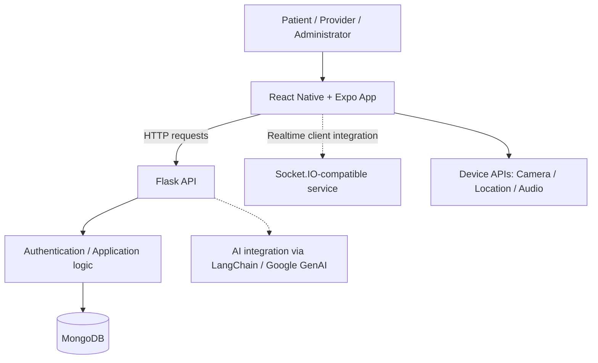
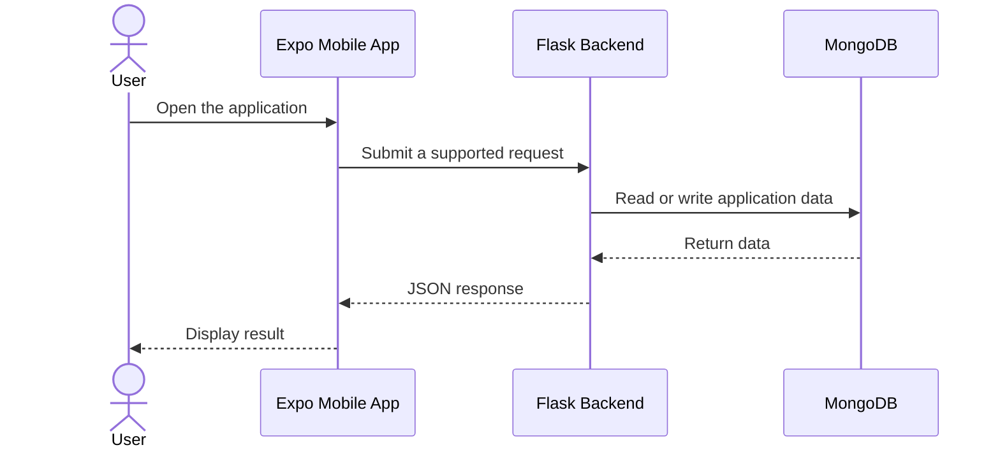

<div align="center">

# 🩺 Medical Application System

### A mobile-first healthcare management project

**React Native · Expo · Flask · MongoDB · Python · TypeScript**

[](https://reactnative.dev/)
[](https://expo.dev/)
[](https://flask.palletsprojects.com/)
[](https://www.mongodb.com/)
[](https://www.python.org/)

[Features](#-project-scope-and-features) · [Architecture](#-system-architecture) · [Getting Started](#-getting-started) · [API](#-api-reference) · [Roadmap](#-roadmap)

</div>

---

## 📌 Overview

**Medical Application System** is a full-stack healthcare application project with a cross-platform **React Native / Expo client** and a **Python Flask backend**. Its documented vision is to connect patients, healthcare providers, and administrators in one place for managing appointments, health records, prescriptions, communication, and emergency workflows.

The project is intended as a **development/prototype system**, not a clinically validated or production-certified healthcare product.

> **Repository status:** The sections below distinguish the *documented project scope* from technologies confirmed in the code/configuration. Some features described in the original repository README have not been independently verified end-to-end. Notably, the Expo app configuration still uses the name `vidya-setu`; review branding before release.

## ✨ Project scope and features

The repository's existing project documentation describes the following feature areas. Availability and completeness should be checked against the current running implementation.

| Area | Described capabilities | Intended users |
|:--|:--|:--|
| 🔐 Identity and access | Registration, login, JWT-based sessions, role-aware experiences | All users |
| 👤 Patient portal | Medical information, appointments, prescription information, documents | Patients |
| 🩺 Provider workspace | Scheduling, patient information, prescriptions, consultations | Healthcare professionals |
| 🛠️ Administration | User management, dashboards, monitoring | Administrators |
| 🚨 Emergency support | Emergency contacts, notifications, location-related workflows | Patients and responders |
| 💬 Communication | Messaging, audio/video-related features, notifications | Patients and providers |
| 🌍 Localization | Multilingual user interface with i18n | All users |

### Technologies visible in the project configuration

- **Cross-platform app:** React Native 0.76, Expo SDK 52, React 18, TypeScript, React Navigation / Expo Router.
- **UI:** NativeWind, React Native Paper, Lucide icons, Lottie animations.
- **Device integrations:** Expo camera, image and document pickers, location, audio, notifications-related media assets.
- **Networking and real time:** Axios and Socket.IO client dependencies.
- **Internationalization:** i18next and react-i18next.
- **Server:** Flask, flask-cors, flask-limiter, PyMongo, PyJWT, bcrypt-related package.
- **AI/audio dependencies:** LangChain, Google Generative AI integration, SpeechRecognition, pydub and ffmpeg-python.

> Installed dependencies indicate available building blocks, **not proof that every corresponding experience is finished or deployed**.

## 🏗 System architecture



**Architecture note:** This is a high-level view of the stack and integrations identified from dependencies and the existing documentation. It is not a verified deployment diagram or evidence of separate microservices.

### Typical interaction flow



## 🧰 Technology stack

| Layer | Tools |
|:--|:--|
| Mobile / web client | React Native, Expo, React Native Web |
| Language / styling | TypeScript, JavaScript, NativeWind |
| Routing / navigation | Expo Router, React Navigation |
| API / backend | Python, Flask, Flask-CORS, Flask-Limiter |
| Persistence | MongoDB / PyMongo |
| Authentication libraries | PyJWT, bcrypt-related dependency |
| Optional AI / speech libraries | LangChain, `langchain_google_genai`, SpeechRecognition, pydub |
| Tooling | Yarn, ESLint, Prettier, Expo CLI |

## 📁 Repository layout

```text
medicine-app/
├── client/                  # Expo / React Native application
│   ├── package.json         # Dependencies and development scripts
│   └── app.json             # Expo application configuration
├── server/                  # Python Flask backend
│   ├── requirements.txt     # Python dependencies
│   └── run.py               # Development server entry point
└── README.md                # Project documentation
```

Only selected paths are shown; this is **not** an exhaustive file tree.

## 🚀 Getting started

### Prerequisites

- Node.js compatible with the project's Expo SDK 52 toolchain.
- **Yarn** (the client specifies Yarn **4.5.3**).
- **Python** and `pip` (use a version compatible with pinned dependencies).
- Access to a **MongoDB** instance and any external services required by the features you intend to test.
- An Android emulator, iOS simulator (macOS), or a compatible physical device. Web development is also supported by the Expo scripts.

### 1. Clone the repository

```bash
git clone https://github.com/purav-12345/Medical-Application.git
cd medicine-app
```

### 2. Run the backend

From the repository root:

```bash
cd server
python -m venv .venv
```

Activate the virtual environment:

```bash
# macOS / Linux
source .venv/bin/activate

# Windows PowerShell
.venv\Scripts\Activate.ps1
```

Install dependencies and launch the Flask development server:

```bash
pip install -r requirements.txt
python run.py
```

`server/run.py` initializes the Flask app with the `development` configuration and launches it with debug enabled. **Do not use this development configuration in production.** The required environment variables depend on the backend configuration; check the source before starting services.

### 3. Run the client

Open a second terminal from the repository root:

```bash
cd client
yarn install
yarn start
```

Other scripts defined by `client/package.json`:

```bash
yarn android  # Open using Android tooling
yarn ios      # Open using iOS tooling (requires macOS/Xcode)
yarn web      # Run the web target
yarn lint     # Run configured lint/format checks
yarn format   # Apply configured formatting
```

> **Network configuration:** When running the application on a physical phone or emulator, `localhost` may refer to the device rather than the development computer. Configure the client's API base URL to point to the reachable Flask server address. Do not embed credentials in the client bundle.

## 🔌 API reference

The repository's existing README lists the following *intended* endpoint paths. **This list has not been reconciled against the Flask route handlers**, so routes and HTTP methods should be checked before integrating them.

| Method | Documented path | Area |
|:--|:--|:--|
| `POST` | `/api/auth/login` | Authentication |
| `POST` | `/api/auth/register` | Authentication |
| `POST` | `/api/auth/refresh` | Token refresh |
| `POST` | `/api/auth/logout` | Logout |
| `GET`, `POST` | `/api/users` | User management |
| `PUT`, `DELETE` | `/api/users/{id}` | User management |
| `GET`, `POST` | `/api/records` | Medical records |
| `PUT`, `DELETE` | `/api/records/{id}` | Medical records |
| `GET`, `POST` | `/api/appointments` | Appointments |
| `PUT`, `DELETE` | `/api/appointments/{id}` | Appointments |

When the route implementation is confirmed, add JSON request/response examples, authentication requirements, and error codes here.

## 🔒 Privacy and security considerations

Medical data is sensitive. Before any real-world deployment:

1. Store secrets in environment variables or a secret manager; never commit credentials or API keys.
2. Enforce role-based authorization on every protected backend endpoint, not only in UI navigation.
3. Validate inputs; protect APIs with appropriately configured CORS, rate limits, and logging.
4. Use HTTPS for transport and suitable encryption and retention controls for stored patient data.
5. Obtain security, privacy, and legal review for any jurisdiction-specific healthcare requirements.
6. Do not use actual patient information in demonstrations or development databases.

**Compliance statement:** Dependencies and README claims alone do **not** establish HIPAA, GDPR, or other regulatory compliance. Verify controls independently before making compliance claims.

## 🗺 Roadmap

Potential future improvements (not claims of existing functionality):

- [ ] Validate and document all backend endpoints with example requests and responses.
- [ ] Add automated frontend and backend tests.
- [ ] Create a reproducible `.env.example` and deployment guide.
- [ ] Align mobile app name, branding, icons, and repository documentation.
- [ ] Add tested role-based patient, provider, and administrator journeys.
- [ ] Document data handling and security architecture.
- [ ] Add screenshots, a product demo, and continuous integration.
- [ ] Evaluate AI-assisted experiences with safety and quality checks before releasing them to users.


## 📄 License

**License not verified.** Review the repository for a published license file before stating reuse or redistribution terms.


<div align="center">

*Building a more connected healthcare experience — responsibly and incrementally.*

</div>
